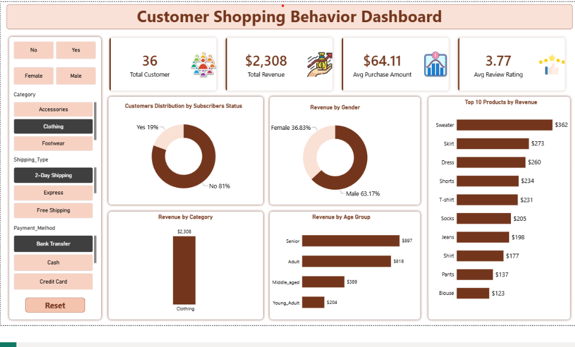

# Customer Shopping Behavior Analysis
## Project Description:
This project focuses on analyzing customer shopping behavior to identify purchasing patterns, understand customer preferences, and generate meaningful business insights from shopping data.

The analysis explores customer demographics, purchasing habits, product preferences, spending patterns, and shopping trends to understand how customers interact with different products and make purchasing decisions.

## Key Highlights:
- Analyzed customer shopping behavior and purchasing patterns.
- Explored customer demographics and shopping preferences.
- Identified trends in product purchases and customer spending.
- Examined customer preferences across different product categories.
- Analyzed purchasing frequency and shopping trends.
- Identified factors influencing customer purchasing decisions.
- Generated meaningful insights through data analysis and visualization.
- Presented data-driven findings to support business decision-making.
  
## Project Objectives:
- Understand customer purchasing behavior.
- Identify popular product categories.
- Analyze customer spending patterns.
- Discover trends in shopping preferences.
- Extract actionable insights from customer data.
- Support better business and marketing strategies.

## Tools & Technologies:
- Python
- Pandas
- NumPy
- Matplotlib
- Seaborn
- Jupyter Notebook
- power BI
- SQL
  
  ## Project Workflow:

1. Data Collection
2. Data Loading
3. Data Cleaning and Preprocessing
4. Exploratory Data Analysis (EDA)
5. Data Visualization
6. Customer Behavior Analysis
7. Insights and Findings

  ## Key Outcomes:

- Better understanding of customer shopping patterns.
- Identification of purchasing trends.
- Insights into customer preferences.
- Data-driven understanding of shopping behavior.
- Improved interpretation of customer data.

